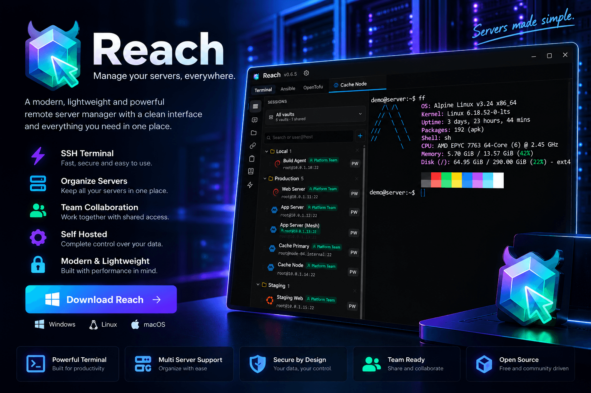

<p align="center">
  
</p>

<h1 align="center">Reach</h1>

<p align="center">
  A modern, cross-platform SSH client and remote management tool.<br>
  Built for engineers who got tired of PuTTY and wanted something that just works.
</p>

<p align="center">
  
  
  
  <a href="https://discord.gg/CSbEybvDVV"></a>
  <a href="https://github.com/sponsors/alexandrosnt"></a>
</p>

<p align="center">
  <a href="https://reachssh.com/"><strong>Documentation</strong></a> · <a href="https://github.com/alexandrosnt/Reach/releases">Download</a> · <a href="https://discord.gg/CSbEybvDVV">Discord</a> · <a href="https://github.com/alexandrosnt/Reach/issues">Report a Bug</a>
</p>

<p align="center">
  <a href="https://alternativeto.net/software/reach-ssh/about/?utm_source=badge&utm_medium=referral">
    
  </a>
</p>

---

<p align="center">
  <a href="https://reachssh.com/download/">
    
  </a>
</p>

---

## Why Reach?

PuTTY hasn't changed in decades, MobaXterm is Windows-only, and Termius charges a subscription for the basics. Reach is an SSH client built from scratch: native Rust networking, a fast UI, encrypted storage, and the same app on Windows, macOS, Linux and Android. No Electron, no subscription, no account.

## Features

### Connect

- **SSH** with tabs, split panes and tab groups, rendered with WebGL.
- **Your `~/.ssh/config`, all of it.** ProxyJump, ProxyCommand, ControlMaster, Kerberos (GSSAPI), X11 forwarding, PKCS#11 and FIDO2 keys, and the rest of the 104 keywords.
- **Remote Desktop (RDP) and VNC** in a tab. RDP shares the clipboard, files and a local folder as a drive.
- **WSL distros and local shells** next to your servers, plus a **serial console** for routers and switches.
- **Host keys checked properly.** Trust on first use, a loud stop when a key changes, and never a silent accept.

### Work

- **Command palette** (Ctrl+Shift+P): any session, tab, page, snippet or action in a few keystrokes.
- **SFTP explorer**: drag and drop, edit in place, compress and extract on the server, drag files straight to your desktop.
- **Port forwarding**: local and SOCKS proxies from the Tunnels panel, plus everything your ssh_config forwards.
- **Snippets** with Tab completion, and **Recipes**: parameterised scripts with a declared risk level, checked before they run.
- **Live server stats** (CPU, memory, disk, network, who's logged in) without installing an agent.
- **Session logging** to plain text files.

### Stay safe

- **Encrypted vault** for sessions, passwords and keys (XChaCha20-Poly1305, Argon2id), with optional encrypted cloud sync.
- **Master password**, plus unlock with Windows Hello, Touch ID, Android biometrics or a FIDO2 security key. Auto-lock when idle or when your computer locks.
- **Password managers**: point a session at a Passbolt entry instead of keeping a copy.
- **Backups** of your sessions and settings, optionally password-protected.
- **Zero-trust defaults**: anything that opens a door, like session sharing or the MCP server, stays off until you switch it on.

### DevOps (opt-in, in Settings → DevOps)

- **Databases**: PostgreSQL, MySQL, MariaDB, SQL Server, SQLite and Redis. A data grid, a schema-aware SQL editor, a table designer that shows the `ALTER` before it runs, and confirmations scaled to the risk. Connect directly or through an SSH session.
- **Containers and Kubernetes**: Docker, Podman, Compose, Kubernetes and Helm on the servers you already reach.
- **Ansible** and **OpenTofu**: run playbooks and plans with streaming output. On Windows, Ansible runs through WSL.

Each tool is off on a fresh install. Switching one off hides it without deleting anything it saved.

### Collaborate

- **Session sharing**: two terminals side by side, peer to peer and end-to-end encrypted. The owner decides whether the other side can type.
- **MCP server**: hand a session to Claude Code, Cursor or any MCP client. Loopback only, with guards against writing blind or reading secrets.
- **AI assistant** with your own API key.

### Make it yours

- **Themes** that colour the whole app, not just the terminal, from a registry pinned by SHA-256.
- **Interface size** (Ctrl+= / Ctrl+-) for the whole window, separate from the terminal's text size.
- **Lua plugins** in a sandbox.
- **Nine languages**: English, German, Spanish, French, Italian, Greek, Bulgarian, Russian and Chinese.
- **A real phone app**: Esc, Ctrl, Alt and arrow keys above the keyboard, pinch to zoom, and a layout that respects notches and large text.

## Download

Get the current release from the [download page](https://reachssh.com/download/):

- Windows: `.exe`, `.msi`
- macOS: `.dmg`, Apple silicon and Intel
- Linux: `.AppImage`, `.deb`, `.rpm`
- Android: `.apk`

Reach is also on Scoop and in apt/dnf repositories, and updates itself once installed. On Android, [Obtainium](https://apps.obtainium.imranr.dev/redirect.html?r=obtainium://add/https://github.com/alexandrosnt/Reach) installs new releases straight from GitHub.

## Built with

[Tauri 2](https://v2.tauri.app), Rust and Svelte 5. The SSH stack is pure Rust ([russh](https://github.com/warp-tech/russh)), with no OpenSSH dependency, and the UI uses the system webview instead of a bundled Chromium, so Reach stays small and light.

| | |
|---|---|
| **Backend** | Rust, Tokio, russh |
| **Frontend** | Svelte 5, SvelteKit, TypeScript, Tailwind CSS 4 |
| **Terminal** | xterm.js with WebGL |
| **Crypto** | XChaCha20-Poly1305, Argon2id, X25519 |

### Build from source

You'll need [Rust](https://rustup.rs), [Node.js 22+](https://nodejs.org) and the [Tauri prerequisites](https://v2.tauri.app/start/prerequisites/) for your OS.

```bash
git clone https://github.com/alexandrosnt/Reach.git
cd Reach
npm install
npm run tauri dev     # run it
npm run tauri build   # package it
```

## Community

- **[Discord](https://discord.gg/CSbEybvDVV)**: questions, ideas, and release announcements.
- **[Issues](https://github.com/alexandrosnt/Reach/issues)**: bug reports and feature requests. For a larger change, open an issue first so we can agree on the approach.
- **[Changelog](CHANGELOG.md)**: what changed in each release.

Pull requests, translations and recipes for the [registry](https://github.com/alexandrosnt/reach-recipes-registry) are all welcome.

## Support

Reach is free and MIT licensed, and it stays that way: nothing is or ever will be paywalled. It's built in spare time with no budget, which is why the installers aren't code-signed yet. If Reach saves you time, **[GitHub Sponsors](https://github.com/sponsors/alexandrosnt)** helps pay for a signing certificate, test hardware, and more evenings spent on Reach. A good bug report or telling a colleague helps just as much.

<a href="https://github.com/alexandrosnt/Reach/graphs/contributors">
  
</a>

## License

[MIT](LICENSE)
